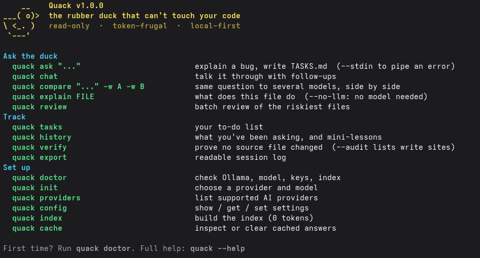
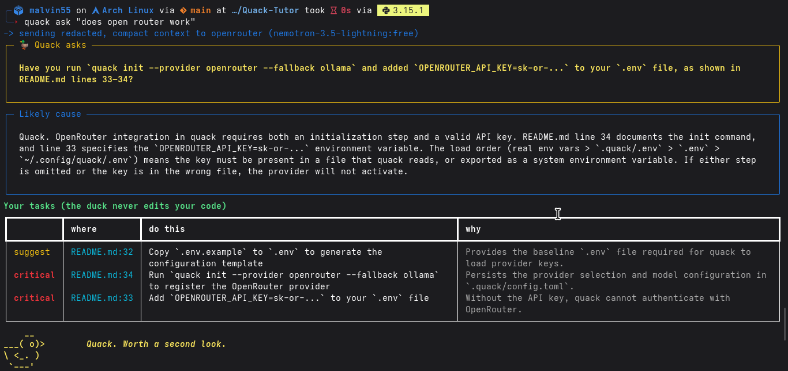

## What I built

Quack is a CLI rubber duck. You describe a bug; it finds the few files that matter, asks **one**
Socratic question, explains the likely cause with `file:line`, and writes a `TASKS.md` for _you_ to
fix. It never edits source. That's enforced in code (a write allowlist) and provable with `quack verify`.

<p align="center">
  
</p>

<p align="center">
  
</p>

**The lazy payoff:** the duck does the tedious part (hunting through the repo, forming a hypothesis,
writing the to-do list) and leaves the part that teaches you something. Pipe a failing test in and walk away:

```bash
pytest -x 2>&1 | quack ask "why does this fail?" --stdin
```

## Why open models mattered

- **Privacy.** Pre-launch code, customer fixtures and internal TODOs are exactly what you shouldn't paste
  into a hosted assistant. Gemma 3 via Ollama keeps everything on the laptop. Quack refuses to contact any
  non-local host until you opt in.
- **Cost and offline.** After `ollama pull gemma3:4b` it runs forever for free, with no internet.
- **Swappable.** One config line moves it to a bigger open-weight model (e.g. Gemma 3 27B on OpenRouter)
  with local fallback, so I could compare models on the same bug.

## Slow and steady: spending tokens like a sloth

- Indexing costs **0 tokens** (filesystem + regex + SQLite, BM25 retrieval).
- Only small line windows around relevant symbols are sent, secrets redacted first.
- Answers are cached for 24h; a repeated question costs **0 tokens**.
- Hard budget of 5000 tokens per ask; context is trimmed to fit.
- Measured on [REPO NAME]: [PASTE depth 1 / 2 / 3 token counts from `quack ask --json`]

## How it works

Index (symbols, term counts, TODOs) → BM25 + symbol/path bonus → windowed context → redact →
structured output (JSON schema via Ollama) → ground (drop tasks pointing at files that don't exist) →
`TASKS.md`. Details in the README.

## What I'd do next

Tree-sitter symbols, embeddings, resumable batch review.

## Partner tech

Gemma (default model), Entire (`quack export` session log), Sentry (opt-in token/latency spans).
[Only keep the ones you actually ran and can show.]

Code: https://github.com/Malvin555/Quack-Tutor
