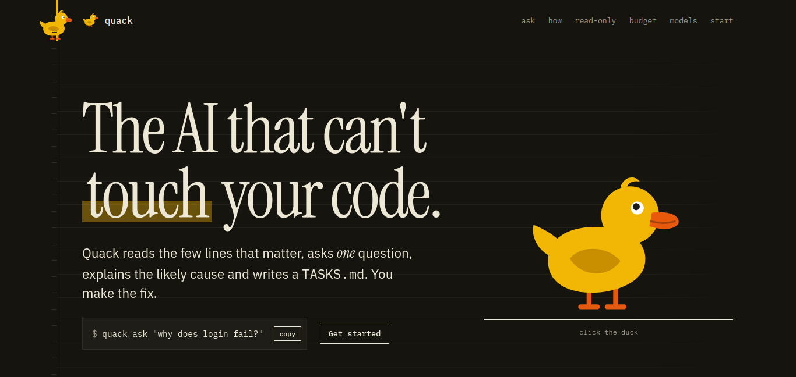

# 🦆 [Quack, the rubber duck tutor](https://quack.wasmer.app/)

<p align="center">
  <a href="https://quack.wasmer.app/">
    
  </a>
</p>

**The AI coding assistant that can't touch your code.**

Quack indexes your repo (zero LLM tokens), retrieves only the few files that matter, asks you
**one Socratic question**, explains the likely cause of a bug, and writes a `TASKS.md` for _you_ to
fix. It never edits source files. It is read-only by construction and can prove it (`quack verify`).

<p align="center">
  <a href="https://quack.wasmer.app/">
    
  </a>
</p>

Built for "Slow and Steady" challenge: the duck conserves tokens, moves deliberately, and lets you do the fix at your own pace.

**Try Quack:** https://quack.wasmer.app/

## Why open models

- **Private by default.** Local Gemma 3 via Ollama means zero cloud egress: pre-launch code,
  customer fixtures and internal TODOs stay on the laptop.
- **Free forever, works offline** after `ollama pull gemma3:4b`.
- **Swappable.** Change the model, or opt in to OpenRouter, Groq, Gemini and other
  OpenAI-compatible APIs when you want a bigger brain (see Providers).

## Install

```bash
pip install -e .            # or: pip install -e ".[rich,git,sentry,dev]"
ollama pull gemma3:4b       # local model (default)
quack doctor                # checks Ollama, model, keys, index
```

## Using a `.env` file for API keys

Local Ollama needs no keys. For a remote provider, copy the template and fill in only what you use:

```bash
cp .env.example .env        # or .quack/.env, or ~/.config/quack/.env
$EDITOR .env                # OPENROUTER_API_KEY=sk-or-...
quack init --provider openrouter --fallback ollama
quack doctor                # shows which .env files were loaded and whether the key is set
```

- Load order: real environment variables win, then `.quack/.env`, `.env`, `~/.config/quack/.env`.
- `.env` files, `*.pem`/`*.key` and SSH keys are **never indexed**, so they can't reach a model.
- A key alone sends nothing anywhere: remote providers stay blocked until `quack init` or `--remote`.
- You can also set `QUACK_PROVIDER`, `QUACK_MODEL`, `QUACK_BASE_URL` in `.env`.
- Keep `.env` out of git (this repo's `.gitignore` already does; add it to your own projects).

## First run

```bash
cd your-project
quack ask "why does session_valid reject valid sessions?"
quack verify                # PASS: no source files were modified
quack tasks                 # your to-do list
```

Pipe a failing test or traceback straight in. Files named in the traceback are pinned into the context:

```bash
pytest -x 2>&1 | quack ask "why does this fail?" --stdin
```

## Commands

| Command                                                                                                    | What it does                                                                                                    |
| ---------------------------------------------------------------------------------------------------------- | --------------------------------------------------------------------------------------------------------------- |
| `quack index [--since REV] [--changed]`                                                                    | Build/update `.quack/index.db`. 0 LLM tokens.                                                                   |
| `quack ask "..." [--depth 1\|2\|3] [--dry-run] [--no-cache] [--model M] [--provider P] [--stdin] [--json]` | Ask the duck. Writes `TASKS.md`.                                                                                |
| `quack explain FILE [--no-llm]`                                                                            | Explain one file from its signatures.                                                                           |
| `quack review [--since REV] [--max-files N] [--batch-size N] [--dry-run]`                                  | Batch review; severity-ranked tasks.                                                                            |
| `quack tasks`                                                                                              | Print `TASKS.md`.                                                                                               |
| `quack history`                                                                                            | Regenerate `QUACK_HISTORY.md` (weekly growth, mini-lessons).                                                    |
| `quack verify [--audit]`                                                                                   | Prove no source changed; `--audit` lists every write site.                                                      |
| `quack chat`                                                                                               | Interactive follow-ups. Slash commands: `/help /files /tasks /depth /model /verify /clear /quit`.               |
| `quack compare "..." -w ollama -w openrouter:MODEL`                                                        | Same question to several models side by side (confidence, tokens, latency, where each points). Writes no tasks. |
| `quack init`                                                                                               | Pick a provider/model; writes `.quack/config.toml`.                                                             |
| `quack providers`                                                                                          | List providers and which are ready.                                                                             |
| `quack doctor`                                                                                             | Check Ollama, model, API keys, index.                                                                           |
| `quack config show\|get\|set`                                                                              | Inspect or change settings.                                                                                     |
| `quack export [-o -]`                                                                                      | Readable session log (default `.quack/session.log`).                                                            |
| `quack cache stats\|clear`                                                                                 | Inspect the 24h answer cache.                                                                                   |

Global: `-C/--root PATH` to work on another repo. Everything works without a model except
`ask`, `explain` (without `--no-llm`) and `review`; `index`, `tasks`, `history`, `verify`,
`explain --no-llm`, `doctor`, `providers` and `config` run fully offline.

## Providers

The default is local Ollama. Remote providers are **opt-in**: Quack refuses to contact any
non-local host until you allow it with `quack init --provider NAME` (or `--remote` for one run).
Only redacted, compact context is sent, and Quack prints a notice before it does.

```bash
export OPENROUTER_API_KEY=...                       # keys live in your env, never in config
quack init --provider openrouter --model google/gemma-3-27b-it --fallback ollama
quack ask "why is login slow?"                      # falls back to local Ollama if OpenRouter fails
quack ask "..." --provider groq --remote            # one-off
```

Built in: `ollama`, `lmstudio`, `llamacpp` (local); `openrouter`, `anthropic` (native Messages API),
`openai`, `groq`, `together`, `mistral`, `deepseek`, `gemini`, `cerebras`, `fireworks`, `huggingface`,
`xai` (remote); and `custom` for any OpenAI-compatible endpoint:

```bash
quack init --provider custom --base-url https://my-host/v1 --api-key-env MY_KEY --model my-model
```

Default model names are suggestions and provider catalogs change; override with `--model`.
A self-hosted open-weight model on a GPU server (for example a DigitalOcean GPU Droplet running
Ollama or vLLM) works through `custom`, or through `ollama` with `quack init --provider ollama
--base-url http://HOST:11434` (counts as remote, so it needs the opt-in).

## Interface

On a real terminal Quack draws an ASCII duck banner, grouped help (`quack` on its own shows the
cheat sheet), panels for the question/cause, a coloured task table and a spinner while the model thinks.
When output is piped, or with `--json` / `QUACK_PLAIN=1`, it prints plain text with no colour codes.

```
    __    Quack v1.0.0
___( o)>  the rubber duck that can't touch your code
\ <_. )   read-only  ·  token-frugal  ·  local-first
 `---'
```

## Token budget

Targets from the spec (`--depth` controls it; context is hard-trimmed to fit `max_tokens_per_ask`, default 5000):

| Operation             | Target tokens                        |
| --------------------- | ------------------------------------ |
| `index`               | 0                                    |
| `ask` depth 1 / 2 / 3 | ~1000-1500 / ~2000-3000 / ~4000-5000 |
| `explain`             | ~1000-2000                           |
| `review` per file     | ~800-1200                            |
| cached `ask`          | 0                                    |

These are design targets. Measure your own with `quack ask ... --json` (provider-reported usage,
estimated at ~4 chars/token when a provider reports none).

## Privacy and safety guarantees

- Writes only `TASKS.md`, `QUACK_HISTORY.md` and `.quack/`. Every write goes through `assert_writable`;
  `quack verify --audit` lists all write sites.
- The only network destination by default is `localhost:11434`. Remote hosts are blocked until opted in.
- Secrets (API keys, GitHub/Slack/AWS tokens, private keys) are redacted before indexing and before any
  text reaches a model.
- Model answers are grounded: tasks pointing at files that don't exist are dropped.
- No telemetry. Optional tracing is off by default (below).
